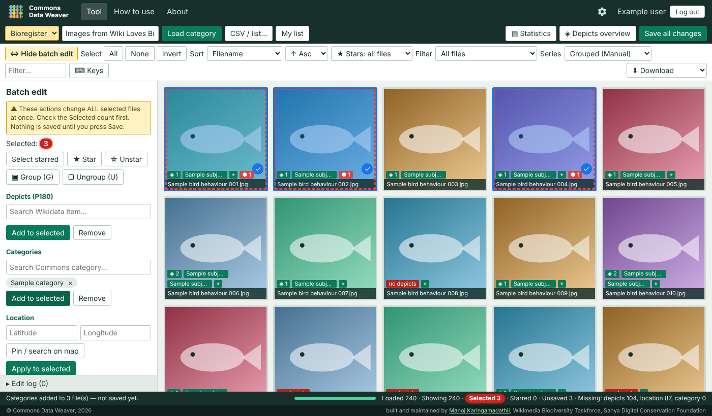
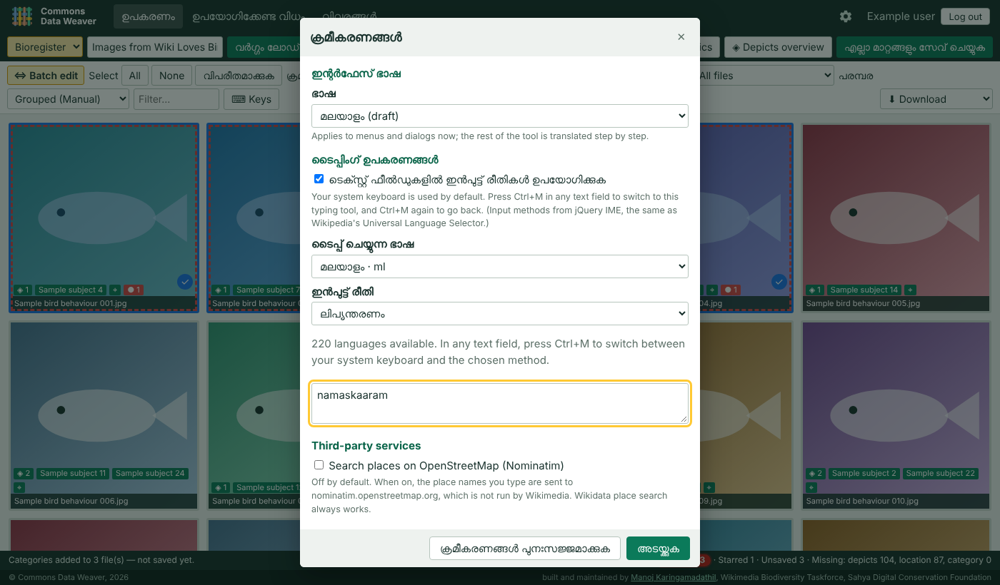
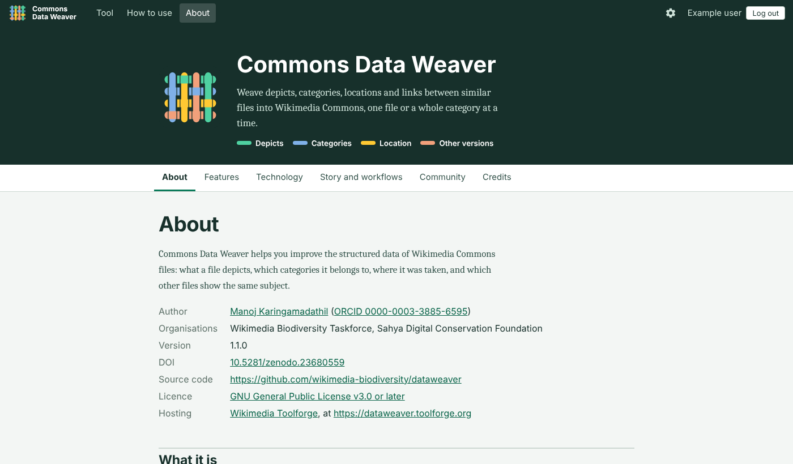
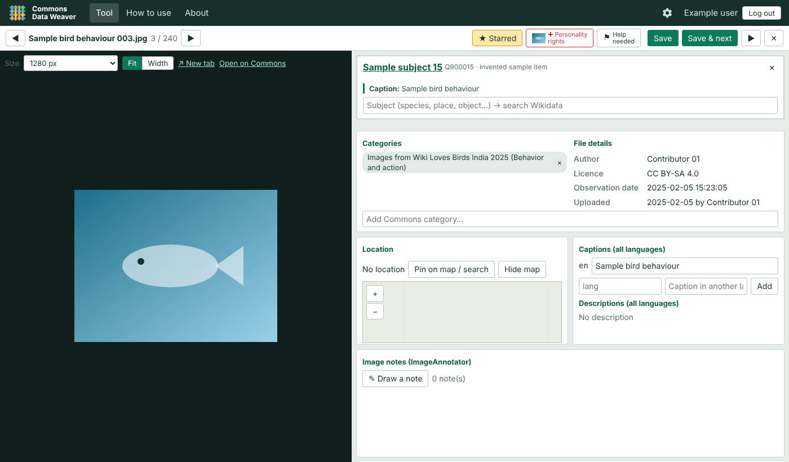
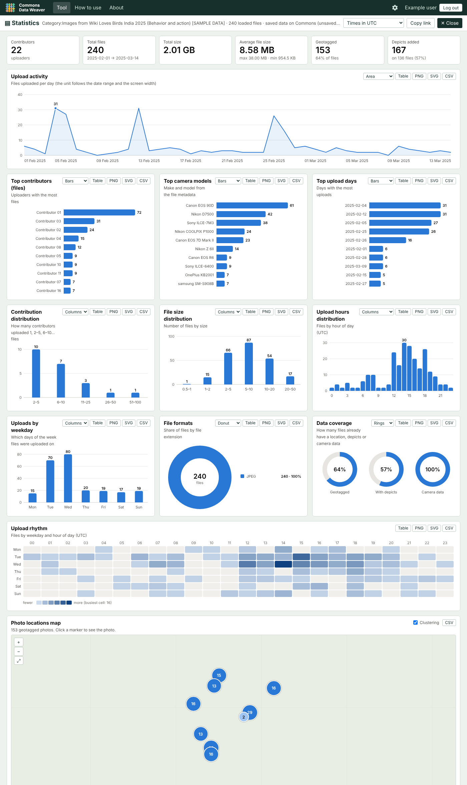

# Commons Data Weaver

**Weave depicts, categories, locations and links between similar files into Wikimedia Commons, one file or a whole category at a time.**

Live: <https://dataweaver.toolforge.org/> · Source: <https://github.com/wikimedia-biodiversity/dataweaver> · DOI: [10.5281/zenodo.23680559](https://doi.org/10.5281/zenodo.23680559) · Licence: GPL-3.0-or-later

Built and maintained by [Manoj Karingamadathil](https://meta.wikimedia.org/wiki/User:Manojk) ([ORCID 0000-0003-3885-6595](https://orcid.org/0000-0003-3885-6595)), Wikimedia Biodiversity Taskforce, Sahya Digital Conservation Foundation.



*Sample data. Unsaved changes are red; selected files are blue.*

## What it does

Load a Commons category, a list of file names or your own list page, review the files in a grid, then add what is missing, in bulk or one file at a time, and save under your own Wikimedia account.

- **Depicts (P180):** search Wikidata, batch add or remove, subject suggestions from the files' categories.
- **Categories:** combined Commons search, suggestions from the Wikidata item's own category.
- **Location:** coordinates, map pin, Wikidata place search (OpenStreetMap search is opt-in); applied to many files at once.
- **Series and Other versions:** group photos of the same subject (manual, or suggested by time or file name), warn when uploaders differ, tag a whole series in a collage, and list the photos in each other's Information template.
- **One file at a time:** a single-screen view with image size and fit, captions (your interface language first), image notes, Personality rights (`P`), and a **Help needed** flag (`H`) that adds a project's help category to problematic files.
- **Statistics:** contributors, sizes, upload activity, cameras, a clustered photo map and a contributions table, with PNG/SVG/CSV downloads for every chart. Open it with `?stats&category=Name`.
- **Also:** stars (`Space`), select invert (`I`), sort and filter with live counts, depicts word cloud and frequency table, JSON/CSV export named after the category, edit log.

The full list is on the [Features page](https://dataweaver.toolforge.org/features) (source: [`templates/features.html`](templates/features.html)).

**Web app extras:** Wikimedia login (OAuth 2.0); a settings gear for the **interface language** and **typing tools** ([jQuery IME](https://github.com/wikimedia/jquery.ime)).

| | |
|---|---|
|  |  |
|  |  |

*The one-by-one and statistics images use invented sample data; the statistics graphics are in [docs/img/stats-example](docs/img/stats-example).*

## How it fits together

```
browser (plain JavaScript) ──reads──► Commons / Wikidata APIs (public, CORS)
        │
        └──writes──► Flask on Toolforge ──OAuth 2.0 Bearer──► Commons API
                       │  login / callback / write proxy (allow-list)
                       └─ sessions.sqlite (tokens encrypted)
```

Reads go straight from the browser. Writes go through `/api/write`, which edits as the logged-in user and only accepts a small allow-list of actions. Tokens never reach JavaScript. See [docs/ARCHITECTURE.md](docs/ARCHITECTURE.md) for the choices and the reasons.

## Quick start (local)

```bash
python -m venv .venv && . .venv/bin/activate
pip install -r requirements-dev.txt
cp .env.example .env          # set SECRET_KEY, and an owner-only OAuth consumer (see below)
make dev                      # http://localhost:5000
make test
```

Without an OAuth consumer everything works except logging in and saving. For login, register an **owner-only** OAuth 2.0 consumer on Meta-Wiki with the callback `http://localhost:5000/oauth/callback`; it is approved automatically ([steps](docs/DEPLOY.md#1-register-the-oauth-consumer)).

## Deploy to Toolforge

```bash
toolforge envvars create SECRET_KEY && toolforge envvars create OAUTH_CLIENT_ID && toolforge envvars create OAUTH_CLIENT_SECRET && toolforge envvars create BASE_URL
toolforge build start https://github.com/wikimedia-biodiversity/dataweaver
toolforge webservice buildservice start --mount=all
```

Full guide, including the consumer registration form: [docs/DEPLOY.md](docs/DEPLOY.md).

## Configuration

Environment variables only; secrets never go in Git. `SECRET_KEY`, `OAUTH_CLIENT_ID`, `OAUTH_CLIENT_SECRET` and `BASE_URL` are required in production. Optional: `DATA_DIR`, `SESSION_DAYS`, `WRITES_PER_MINUTE`, `MAXLAG`, `TILE_URL`, `NOMINATIM_URL`, `CONTACT`. The table is in [docs/DEPLOY.md](docs/DEPLOY.md#2-configure-the-tool); `.env.example` shows a development setup.

## Repository layout

```
app.py                      WSGI entry point (gunicorn app:app)
Procfile, requirements.txt  Toolforge Build Service
dataweaver/                 Flask app: auth.py, proxy.py, store.py, pages.py, config.py
templates/                  Pages: tool shell, About, Features, Technology, Story, Community, Credits, How to use, Privacy
static/js/dataweaver.js     The tool's interface (edited directly since 1.1.0)
static/js/dw-stats.js       Statistics page: calculations, SVG charts, map with clustering
static/config/projects.json Projects and each project's "help needed" category
static/js/dw-shim.js        MediaWiki helpers the interface expects (mw.Api, mw.config, …)
static/js/dw-site.js        Navigation, login state, settings gear, localisation, typing tools
static/i18n/                en.json, qqq.json, ml.json (draft), languages.json
static/vendor/              jQuery and jQuery IME, served from this site
tests/                      pytest: backend, pages, headless-browser end-to-end
tools/                      screenshots.py, sample_data.py (invented data); port_userscript.py (1.0.0 baseline only)
docs/                       DEPLOY.md, ARCHITECTURE.md, screenshots
```

## Languages and typing tools

The gear in the top bar sets the interface language and input methods. To add a language, copy `static/i18n/en.json`, translate it, and list it in `languages.json`; to translate the tool's own labels, add `"English text": "translation"` pairs under `"@app"`. Details in [CONTRIBUTING.md](CONTRIBUTING.md#translations). Only a draft Malayalam starter is included so far.

## Tests

```bash
make test-fast    # backend (OAuth, proxy allow-list, sessions) and pages (links, i18n, no inline scripts)
make test         # adds headless Chromium: boot, load, select, stage, save through the proxy, language, typing, one-by-one view, Help flag, statistics
```

The Wikimedia APIs are faked in all tests; no real wiki is contacted. CI runs the same on every push (`.github/workflows/ci.yml`).

## Publish to Git

```bash
git init -b main
git add . && git commit -m "Commons Data Weaver web app"
git remote add origin git@github.com:wikimedia-biodiversity/dataweaver.git
git push -u origin main
```

`.gitignore` already excludes `.env`, `var/` and session databases. Tag a release (`git tag v1.1.0`) to get a new Zenodo DOI version if the repository is linked to Zenodo.

## Contributing

Issues and pull requests are welcome; see [CONTRIBUTING.md](CONTRIBUTING.md). Please follow the [Universal Code of Conduct](https://foundation.wikimedia.org/wiki/Policy:Universal_Code_of_Conduct).

## Licence and credits

GPL-3.0-or-later, see [LICENSE](LICENSE). Vendored: jQuery IME (GPL-3.0-or-later or MIT) and jQuery (MIT), see [static/vendor/README.md](static/vendor/README.md). Credits for ideas, data and platform are on the [Credits page](https://dataweaver.toolforge.org/credits).

To cite: see [CITATION.cff](CITATION.cff) or DOI [10.5281/zenodo.23680559](https://doi.org/10.5281/zenodo.23680559).
